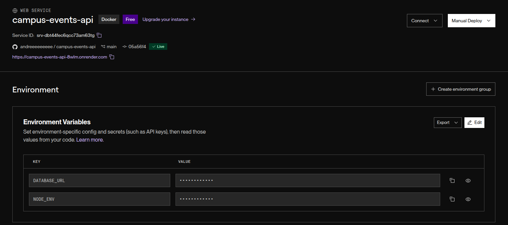
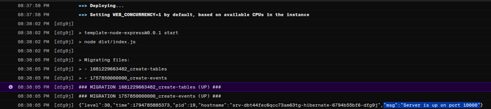
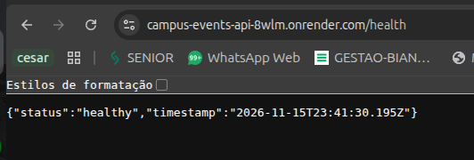
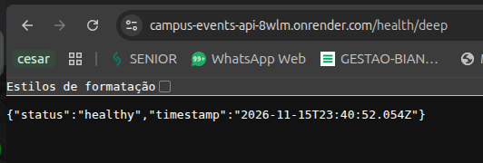
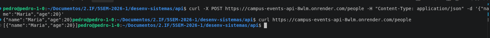
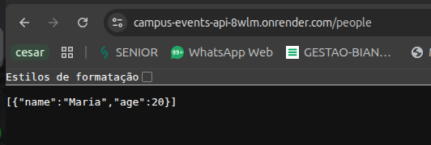

## Deploy

A API está publicada no Render, em um Web Service Docker, conectado a um PostgreSQL gerenciado do próprio Render.

- **URL pública:** https://campus-events-api-8wlm.onrender.com
- **Plataforma:** Render (plano Free)
- **Banco de dados:** PostgreSQL do Render, acessado pela URL interna, na mesma região do serviço (Virginia, US East)
- **Deploy:** automático a partir da branch `main`, usando o `Dockerfile` do projeto

### Variáveis de ambiente

| Variável       | Descrição                                      |
| -------------- | ---------------------------------------------- |
| `DATABASE_URL` | Internal Database URL do PostgreSQL do Render  |
| `NODE_ENV`     | `production`                                   |
| `PORT`         | Definida automaticamente pelo Render (`10000`) |

Os valores reais ficam apenas no painel do Render e não são versionados.



### Como foi publicado

1. Criado um PostgreSQL no Render.
2. Criado um Web Service (linguagem Docker) apontando para este repositório, branch `main`.
3. Configuradas as variáveis `DATABASE_URL` e `NODE_ENV`.
4. Definido o Health Check Path como `/health`.
5. As migrations rodam automaticamente quando a aplicação sobe.



### Como acessar e validar

> No plano gratuito a instância hiberna após inatividade, então a primeira requisição pode demorar cerca de 50 segundos.

A API não define rota em `/`, então abrir apenas a URL base retorna `404 Route not found`. Isso é esperado.

**1. Health check da API**

```bash
curl https://campus-events-api-8wlm.onrender.com/health
```

Resposta esperada: `{"status":"healthy","timestamp":"..."}`



**2. Health check com banco de dados**

```bash
curl https://campus-events-api-8wlm.onrender.com/health/deep
```

Resposta esperada: `{"status":"healthy","timestamp":"..."}`. Se a conexão com o banco falhar, retorna `503`.



**3. Criar e listar pessoas (escrita e leitura no banco)**

```bash
curl -X POST https://campus-events-api-8wlm.onrender.com/people \
  -H "Content-Type: application/json" \
  -d '{"name":"Maria","age":20}'

curl https://campus-events-api-8wlm.onrender.com/people
```



